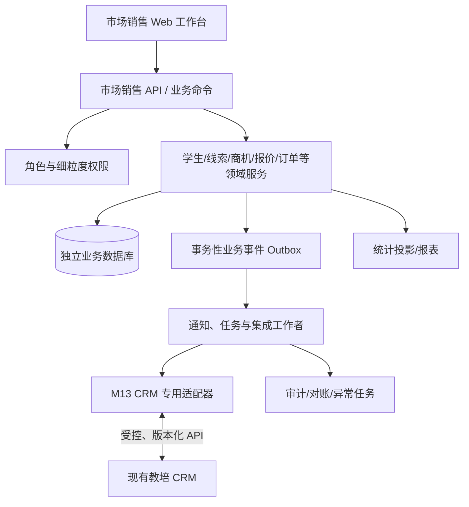
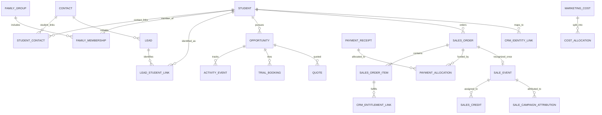

# 市场与销售系统技术规格说明书

**文档编号**：MS-TECH-001  
**版本**：V3.0（独立技术设计稿，待业务决策与接口验证后批准为实施基线）  
**日期**：2026-11-13  
**对应需求**：《市场与销售系统需求总纲》V2.8；《统一数据模型与跨模块数据字典》V1.0  
**所属系统**：独立市场与销售系统（M01—M14）  
**文档管理原则**：本文件**独立维护**；不得在项目正式完成集成及联合验收前融合进现有教培 CRM 的技术文档。  
**核查基准**：现有 CRM 私有仓库 `Lizhaochuan/edu-management-system` 的 `work` 分支；本轮静态核查时 HEAD `30c097f3776caf709b2a55577f3f98d83c09f928`。  
**证据级别**：现有 CRM 源代码和仓库资料已只读检查；新市场销售系统的数据库、接口与页面**均为拟建规格**，未开发、未部署、未运行验收。

---

## 0. 文档边界与决策状态

### 0.1 使用规则

1. **已确认**：此前明确选定的业务规则，开发不得自行变更。
2. **设计建议**：为使技术方案可落地而提出的技术约束；实施前须纳入评审，不得伪称已由业务负责人批准。
3. **待业务确认**：会影响金额、招生政策、教学权利或人员权限的决定；不得由 AI 或开发人员私自决定。
4. **待技术验证**：现有 CRM 仓库发现基础能力，但接口、部署或端到端行为尚未核实。
5. **阻断项**：未解决前不允许进入涉及真实客户、收款或课程权益的正式运行。

本文件既不是现有 CRM 的实施报告，也不是已通过验收的“最终融合文档”。最终融合另有独立验收门槛，见第 17 节。

### 0.2 已确定的需求决策基线

| 决策 | 状态 | 技术落实点 |
|---|---|---|
| ADR-001 独立开发/部署/数据库；通过 API 分阶段与 CRM 集成 | 已确认 | 不直接共享或修改业务数据库；建立 M13 适配层 |
| M01 首次来源与本次商机来源双口径 | 已确认 | `student_acquisition` 与 `opportunity.source_channel_id` 分开 |
| M02 一笔成交一个主要活动、多个辅助活动 | 已确认 | 以**学生订单成交事件**为归因对象，主活动最多一个 |
| M03 回访旧学生默认归原学生负责人，主管可重新分配 | 已确认（由 V2.8 改写主体） | 学生归属快照与可审计转交 |
| M04 学生为主要客户单位，家庭按需关联 | 已确认（BR-M04-001） | 独立学生、联系人、关系表、可选家庭关联 |
| M05 日常跟进简化、关键节点结构化 | 已确认 | 沟通事件可关联多个学生，重要事件由对应业务对象认定 |
| M06 商机负责人默认继承学生负责人，主管可另行指定 | 已确认（由 V2.8 改写主体） | 学生/商机双负责人，成交快照 |
| M07 第一阶段经现有 CRM 接口确认试听排课 | 已确认目标，技术待核查 | 权威排课、幂等、超时结果核实 |
| M08 标准课程及标准价格由现有 CRM 权威管理 | 已确认目标，技术待核查 | 只读价格投影、报价快照和有效性核验 |
| M09 **全额付款才认定正式成交** | 已确认 | 独立应收/收款/成交/权益状态 |
| M10 默认归成交时商机负责人，可由主管审批多人业绩比例=100% | 已确认 | 成交事件与分配版本；金额不重复 |
| M11 市场费按实际用途分配，不确定的费用独立待分配 | 已确认 | 费用唯一记录、分摊与余额约束 |
| M12 预设角色 + 可配置权限 | 已确认 | 模块/操作/数据范围/字段/审批四层控制 |
| M13 CRM 学员身份自动查找；可信编号自动关联，疑似匹配人工确认 | 已确认 | 学生身份映射状态机与人工复核 |
| M14 低风险自动执行，高风险需授权审批 | 已确认 | 规则白名单、任务去重、受控执行主体 |

> 已确认“一个主要活动”的规则仍然有效。本版以每名学生的独立订单为默认成交归因单元；跨学生组合报名是**独立订单 + 可关联的组合付款**，不是额外的“家庭成交”金额。若未来采用单一跨学生法定订单，需另行批准归因和税务处理。

### 0.3 不属于本系统的权威事务

正式课程目录、标准价格、教师及教室资源、排课、正式学员登记、课时权益、实际消课由现有 CRM 权威维护；实际资金到账须由**指定的财务权威系统/有效对账流程**确认。市场销售系统的“收款投影”不得代替真实收款事实。现有 CRM 的手工收款确认不是自动银行/支付平台验证。

---

## 1. 系统目标、范围与非目标

### 1.1 功能范围

- M01 渠道；M02 活动与费用；M03 线索；M04 学生客户、联系人与家庭关联；M05 跟进与任务；M06 商机；M07 试听；M08 课程方案与报价；M09 报名订单及收款关联；M10 业绩；M11 经营分析；M12 权限与审计；M13 CRM 集成；M14 自动化运营。
- 第一阶段允许新系统的客户及销售流程独立工作；需要教学权威确认的步骤不得使用本地伪造结果。
- 优先服务内部员工；客户外部消息和家长登录另行评审。

### 1.2 非目标

- 不重写现有 CRM 的签到、消课、教师课酬、班级管理、正式课程标准定价。
- 不将市场销售系统的销售状态当作财务到账凭证。
- 不把家庭关系作为必填学员归属或自动跨学生权限。
- 不在本阶段替换现有 CRM 的本地 JSON 持久化方式，也不在新系统中直接编辑其 `data/db.json`。
- 不在尚未建立合法授权与通道条件时自动发送家长营销短信/微信消息。

---

## 2. 参考技术架构（建议，待技术选型评审）

**建议实现技术**：后端 TypeScript/Node.js、关系型数据库 PostgreSQL、Web 管理界面使用团队已掌握的框架。队列/Redis 可选，不能把消息队列当作唯一的持久业务事实。此选型不是已确认决策；技术评审可选择满足事务、一致性和维护要求的等价组合。

**部署约束**：新系统与 CRM 独立配置、密钥、持久化和备份；集成调用应采取专属服务身份、最小权限、TLS、明确超时和访问日志。正式生产部署前完成容量、数据保护、备份恢复、监控与实际 GUI 验收。

### 2.1 统一标识与时间规范

- 主键推荐 UUID/ULID；不可直接把家长电话或学生姓名作为身份主键。
- 外部系统编号使用 `(external_system, external_tenant, external_type, external_id)` 命名空间，不假定不同系统 ID 不冲突。
- 金额采用整数最小货币单位（人民币：分；例如 ¥8,000.00 = 800000 分）；禁止用二进制浮点数直接汇总资金。
- 教学时长存储 `duration_minutes`，计费数量存储 `billing_quantity DECIMAL(16,4)` 和 `billing_unit`；明确“课时数 ≠ 课程次数 ≠ 分钟数”。
- 内部时间使用带时区的 UTC 时间戳；界面显示机构业务时区。默认时区可建议 `Asia/Shanghai`，最终以机构配置为准。
- 删除原则上软删除或业务停用；已确认成交、财务、审批、归因与审计事件不可物理覆盖。
- 各核心对象保留 `version`、`created_at`、`updated_at`、`created_by`，必要时有 `archived_at`。
- 系统如存在多校区，预留 `organization_id`、`campus_id`；真实校区权限模型须确认，不能简单以字符串隐藏隔离问题。

---

## 3. 统一业务关系模型

**关系解释**：默认一名学生一份独立销售订单；家长一次付多笔订单的业务通过 `PAYMENT_RECEIPT`、`PAYMENT_ALLOCATION` 实现。家庭仅为已核实的学生关系组，**不直接持有订单、成交额或默认销售负责人**。

---

## 4. 核心数据字典与数据库约束

本节定义**逻辑数据结构**，不是直接执行的生产 SQL。表名为新市场销售系统建议命名，不对应现有 CRM 的物理表。

### 4.1 学生、联系人、家庭（M03/M04/M12/M13）

| 建议实体 | 关键字段 | 必须的约束/说明 |
|---|---|---|
| `student` | `id, display_name, grade, school, owner_user_id, status, first_source_event_id, version` | 学生编号唯一；姓名变化不改变 ID；独立负责人 |
| `contact` | `id, name, normalized_phone, wechat_handle, contact_preferences, do_not_contact` | 手机号敏感，不能全局唯一化为学生/家庭 ID；禁止联系标记受控 |
| `student_contact` | `id, student_id, contact_id, relation_type, primary_flag, verified_at, valid_from, valid_to` | 同一联系人可关联多学生；同一学生可有多联系人；关系有时间性 |
| `family_group` | `id, display_name, verification_state, verified_by, verified_at, status` | 默认不创建；仅对确认存在多学生共同家庭关系时激活 |
| `family_membership` | `id, family_group_id, student_id, relationship_basis, verified_at, revoked_at` | 同一有效家庭成员关系不能重复；错误关联可受控撤销 |
| `student_owner_history` | `student_id, old_owner, new_owner, reason, approved_by, effective_at` | 负责人转交留痕，不追溯改动历史业绩 |
| `crm_identity_link` | `id, student_id, external_system, external_student_id, verification_method, status, verified_by, verified_at` | 有效链接防冲突；可信外部编号必须由 CRM 验证；疑似匹配待人工审批 |

**核心规则**：同电话既可能是兄弟姐妹，也可能是不同家庭、亲属代理或重复录入；不可仅凭电话合并。学生身份未明确时可只创建联系人和待识别线索，不可伪造一个学生。家庭关联解除不级联删除任一学生及其业务记录。

**索引建议**：`student(owner_user_id, status)`；`student_contact(student_id, valid_to)`；`student_contact(contact_id, valid_to)`；`crm_identity_link(external_system, external_student_id)`；手机号使用经审查的安全查询策略，不应对普通人员开放全量精确手机号检索。

### 4.2 渠道、营销活动和费用（M01/M02/M11）

| 实体 | 关键字段 | 约束 |
|---|---|---|
| `marketing_channel` | `id, name, parent_id, channel_type, active` | 停用不影响历史归因 |
| `marketing_campaign` | `id, name, start_at, end_at, owner, status, budget_cents` | 活动独立编号；预算与实际费用分离 |
| `contact_event` | `id, contact_id, occurred_at, channel_id, campaign_id, event_type, original_source` | 一次真实来电/咨询只建一个事件；可关联多个学生 |
| `contact_event_student` | `contact_event_id, student_id, association_basis` | 复合唯一，避免同一咨询对一名学生重复关联 |
| `student_acquisition` | `student_id, first_event_id, source_channel_id, source_status, corrected_reason` | 学生首次来源主记录；历史更正受控且保留原值 |
| `campaign_participation` | `campaign_id, student_id or lead_id, participation_at, result` | 不因家庭关联而自动将两个孩子都视为参与 |
| `marketing_cost` | `id, amount_cents, occurrence_date, cost_type, evidence_ref, state` | 原始费用唯一，不与其他分析维度重复相加 |
| `cost_allocation` | `id, marketing_cost_id, channel_id?, campaign_id?, allocated_cents, basis, approved_by` | 实际用途分配；剩余金额自动计算为待分配 |

**费用守恒**：每笔有效费用 `原始金额 = 已分配总额 + 待分配余额`，不得超额、虚假平均或依据线索数量擅自分摊。渠道和活动是**两种不同维度**，若同一分配同时标注渠道、活动，不能在机构总额层面将其简单相加。

**营销归因**：每个学生的首次来源与每个商机的当前来源独立；每个学生订单产生的 `sale_event` 在主要活动维度最多一个主活动，辅助活动不增加机构成交额。历史来源未知应明确显示未知。

### 4.3 线索、跟进、商机（M03/M05/M06/M14）

| 实体 | 关键字段 | 约束 |
|---|---|---|
| `lead` | `id, contact_id?, source_event_id, owner_user_id?, status, created_at, identified_at` | 未确认学生前仍可存在；不能在未核实情况下自动并入其他学生 |
| `lead_student_link` | `lead_id, student_id, confirmation_state, confirmed_by` | 一次咨询可能涉及多学生；可选关联 |
| `opportunity` | `id, student_id, owner_user_id, source_channel_id, stage, lifecycle_state, predicted_amount_cents, version` | 正式商机必须指向具体学生；默认继承学生负责人，主管可改派 |
| `interaction` | `id, occurred_at, channel, summary, recorded_by, source_event_id?` | 一次实际沟通只记录一次；对多学生使用关联表 |
| `interaction_subject` | `interaction_id, student_id?, opportunity_id?, lead_id?` | 访问时根据实际关联及当前权限裁剪详情 |
| `sales_task` | `id, student_id?, opportunity_id?, assignee_id, due_at, state, automation_dedupe_key?` | 防止自动化重复生成同一任务 |
| `opportunity_stage_history` | `opportunity_id, from_stage, to_stage, reason, actor_id, at` | 人工改阶段不能伪造试听完成、到账或已成交事件 |

### 4.4 试听、课程、价格与报价（M07/M08/M13）

| 实体 | 关键字段 | 约束 |
|---|---|---|
| `crm_course_projection` | `crm_course_id, name, class_type, standard_unit_price_cents, billing_unit, duration_minutes, sellable, source_version, fetched_at` | CRM 的只读投影；缺价格版本时明示待核实 |
| `trial_booking` | `id, student_id, opportunity_id?, crm_trial_id?, crm_schedule_id?, requested_slot, confirmed_slot?, booking_state, attendance_state, request_key` | 申请不等于确认；CRM 才能占用资源 |
| `trial_feedback` | `trial_booking_id, student_id, teacher_ref, completion_result, feedback_summary, submitted_at` | 未得到实际出勤/完成确认，不得凭预约时间自动判定试听完成 |
| `quote` | `id, student_id, opportunity_id, version, valid_until, approval_state, delivery_state, total_cents` | 版本不覆盖；批准绑定该版本 |
| `quote_item` | `quote_id, crm_course_id, price_source_version, billing_unit, quantity, duration_minutes, standard_price_cents, discount_cents, final_cents` | 记录原标准价、批准优惠、明确计费单位 |
| `discount_approval` | `quote_id, quote_version, type, amount_cents, requester_id, approver_id, outcome` | 禁止自审/旧批准转用新报价 |

**CRM 价格变更**：报价快照永久保存；是否在有效期内保障原报价为**待业务确认**。销售系统不能把旧缓存价格直接标为当前有效的正式报价。

### 4.5 订单、付款、退款、成交与课时（M09/M10/M13）

| 实体 | 关键字段 | 约束 |
|---|---|---|
| `sales_order` | `id, student_id, opportunity_id, quote_id, quote_version, amount_due_cents, order_state, payment_state, crm_fulfillment_state, version` | 默认单学生；报名申请与付款状态分离 |
| `sales_order_item` | `id, order_id, crm_course_id, quantity, billing_unit, duration_minutes, paid_units, gift_units, line_total_cents, price_snapshot` | 每个购买权益精确指向学生及课程 |
| `payment_receipt_projection` | `id, authority_system, external_payment_id, amount_cents, currency, verified_state, verified_at, actual_received_at, source_record_ref` | 仅存权威到账事实的同步视图；外部交易编号按来源唯一 |
| `payment_allocation` | `id, receipt_id, order_id, allocated_cents, confirmation_state, confirmed_by, basis_ref` | 资金分配到独立学生订单；未核实付款不得认定已付清 |
| `refund_projection` | `id, authority_system, external_refund_id, payment_receipt_id?, order_id?, amount_cents, verified_state, actual_refunded_at` | 退款确认必须来自授权财务权威来源 |
| `refund_allocation` | `refund_id, order_id, order_item_id?, amount_cents, reason` | 不能重复冲回同一退款金额 |
| `sale_event` | `id, order_id, recognized_amount_cents, recognized_at, ingested_at, owner_snapshot_id, attribution_snapshot, authority_evidence` | 同一订单首次成交事件至多一个；后续退款不删除原事件 |
| `sales_credit` | `sale_event_id, version, salesperson_id, share_basis_points, allocated_cents, approval_ref` | 同一有效版本比例合计 10000 基点；金额合计等于被分配金额 |
| `sales_credit_adjustment` | `id, sale_event_id, refund_ref?, amount_delta_cents, effective_at, reason, allocation_version` | 追加调整，不抹除成交历史 |
| `crm_entitlement_link` | `order_item_id, crm_package_id, crm_student_id, provisioning_request_key, fulfillment_state, verified_at` | 同一购买明细不重复生成课时包；确认 CRM 业务结果 |

**付款分配不变量**：`sum(有效 payment_allocation.allocated_cents per receipt) <= 已确认且未被冲正的该笔收款可用金额`；`sum(每订单有效净收款分配)` 仅可用于该订单的结清判断；不允许把一笔 ¥6,000 收款同时充当哥哥 ¥6,000 与妹妹 ¥4,000 的全部付款。

**业绩分配舍入**：建议先按比例计算整数分，余数按确定性的最大余数法和稳定人员顺序归属；保存分配版本与计算明细。跨团队汇总只聚合已分配金额一次，不重新计算机构成交总额。

### 4.6 权限、审计、集成和自动化（M12/M13/M14）

| 实体 | 关键字段 | 约束 |
|---|---|---|
| `staff_user` / `role_template` / `role_grant` | 用户、角色、组织、权限、有效时间 | 预设角色 + 可配置权限，不允许用户自我提权 |
| `data_scope_grant` / `field_policy` | 资源范围、字段级可读/可写/脱敏策略 | 家庭关联不自动扩大权限；服务端强制执行 |
| `approval_case` | 业务对象、版本、变更内容、申请人、审批人、状态 | 审批不得越过流程；冲突时使用授权上级 |
| `audit_event` | 对象、事件、前后业务值、执行主体、原因、时间、请求追踪号 | 追加式记录；面向用户展示可读业务差异 |
| `integration_outbox` | `id, event_type, object_id, payload_version, state, next_retry_at` | 本地业务事务与待发送事件共同提交 |
| `integration_inbox` | 外部事件唯一编号、来源、签名/认证、已处理状态 | 防重复、乱序、重放 |
| `integration_task` | 请求键、外部对象编号、重试、结果待核实状态、错误类别 | 超时不许直接判失败后换键重写 |
| `reconciliation_run` | 批次、源系统范围、发现差异、处理状态 | 金额、订单、课时与身份差异可追踪 |
| `automation_rule` | 触发条件、允许动作白名单、配置版本、责任人、启停 | 高风险动作需要批准且每次检查权限 |
| `automation_execution` | 规则版本、事件、去重键、执行结果、实际作用对象 | 避免重复提醒与错误执行 |

**数据保留**：财务、学生信息和审计记录的实际保留期限应由机构结合适用法律、客户信息处理目的确定。不得随意采用“永不删除所有个人资料”的默认做法。

---

## 5. 业务状态机与事件语义

### 5.1 学生与线索

- 未知学生的咨询先为 `lead: new/unidentified`；识别后可关联一个或多个学生。
- 学生本身可处于潜在、已报名、暂停等**展示或衍生状态**；CRM 正式在读事实不得仅通过修改本地学生状态产生。
- 学生负责人变化记录 `student_owner_history`；原商机负责人、原成交快照均不自动回写。

### 5.2 商机

建议阶段：`new → contacted → needs_confirmed → trial_planned → trial_completed → quoted → negotiation → won/lost/closed`，但不同路径可跳过不适用阶段。阶段推进应受业务事实校验；`won` 必须关联有效 `sale_event`，不能由人工手动编辑阶段制造成交。

### 5.3 试听

**预约状态**：`draft → requested → confirming → confirmed → completed/cancelled`，另有 `confirmation_unknown` 和 `manual_review`。  
**试听实际结果**单独记录：`not_started / attended / absent / cancelled / feedback_pending / feedback_completed`。  
时段冲突、教室占用和正式写入确认由 CRM 负责；“请求已发送”和“CRM 已确认预约”必须有不同界面展示。

### 5.4 报价

`draft → approval_pending → approved → sent → accepted/expired/revoked`。被拒审批后进入可修改新版本，已发送版本不可无痕覆盖。正式报名时校验价格、可售状态及审批仍有效。

### 5.5 订单、收款、成交、权益：四套独立状态

| 维度 | 状态建议 | 权威 |
|---|---|---|
| 报名订单 | `draft / submitted / accepted / cancelled / closed` | M09 |
| 付款 | `unpaid / partially_paid / fully_paid / disputed / adjusted` | 基于财务权威事实计算 |
| 成交 | `not_recognized / recognized / adjusted_after_sale` | M09 唯一成交事件及后续追加调整 |
| CRM 交接 | `not_requested / pending / unknown / completed / manual_review` | M13 依据 CRM 回执/状态查询 |

**成交条件（已确认）**：订单有效，指定财务权威来源证明该订单已分配净收款足额，且该订单没有阻止成交的业务异常，才生成单一正式 `sale_event`。禁止将未付款、部分付款、截图或销售手工勾选作为成交证据。

**先开课后付清**：是否允许未全额付款先在 CRM 开通教学权益，仍然**待业务确认**。无论选择如何，不改变正式成交认定条件。

**退款及冲正**：原始 `sale_event` 不删除；财务退款/收款撤销由相应独立事件反映。发生付款事实撤销导致原成交条件不再满足时，保留原历史及追加纠错与净额调整，不能重复生成另一笔初始成交事件。

### 5.6 系统事件建议

`LeadCreated`、`StudentIdentified`、`StudentOwnerChanged`、`OpportunityAssigned`、`TrialRequested`、`TrialConfirmed`、`TrialCompleted`、`QuoteApproved`、`OrderSubmitted`、`PaymentReceiptVerified`、`PaymentAllocated`、`OrderFullyPaid`、`SaleRecognized`、`RefundConfirmed`、`SalesCreditApproved`、`EntitlementProvisioned`、`IntegrationOutcomeUnknown`。

**事务要求**：本地订单状态修改和相应 outbox 事件应在同一个新系统数据库事务提交。跨 CRM 的调用不属于同一个本地事务，需要幂等、状态核实、补偿和最终对账。

---

## 6. 拟建 API 契约（新系统）

**说明：以下为拟建接口，现有 CRM 并不存在这些全部端点。** 路由采用示例 `/api/v1`，具体框架与 HTTP 方法需在接口评审时冻结。写接口必须身份认证、数据范围权限校验、审计及必要的 `Idempotency-Key`；非幂等操作不得以 GET 发起。

### 6.1 市场销售系统内部 API

| 方法 | 路径（建议） | 说明 |
|---|---|---|
| `POST` | `/api/v1/leads` | 创建允许暂未识别学生的线索 |
| `POST` | `/api/v1/leads/{id}/students` | 核实并关联线索涉及的学生 |
| `POST` | `/api/v1/students` | 新建学生客户 |
| `POST` | `/api/v1/students/{id}/contacts` | 关联联系人与关系 |
| `POST` | `/api/v1/family-groups` | 核实后建立可选家庭关系 |
| `POST` | `/api/v1/opportunities` | 创建单学生商机 |
| `POST` | `/api/v1/opportunities/{id}/interactions` | 创建可追踪沟通事件 |
| `POST` | `/api/v1/trials` | 发起试听需求 |
| `POST` | `/api/v1/quotes` | 以 CRM 当前价格生成报价草稿 |
| `POST` | `/api/v1/quotes/{id}/submit-approval` | 申请特殊优惠审批 |
| `POST` | `/api/v1/orders` | 从已批准有效报价生成学生订单 |
| `POST` | `/api/v1/orders/{id}/payment-allocations` | 提交有财务依据的收款分配申请/引用 |
| `GET` | `/api/v1/orders/{id}/settlement` | 查询应付、有效实收、未付与成交状态 |
| `POST` | `/api/v1/sales/{id}/credit-approvals` | 申请多人业绩分配或更正 |
| `GET` | `/api/v1/reports/acquisition` | 带来源口径的学生获客报告 |
| `GET` | `/api/v1/reports/funnel` | 指定线索批次/期间的漏斗分析 |
| `GET` | `/api/v1/integrations/tasks` | 同步状态与异常管理 |
| `GET` | `/api/v1/audit` | 已授权的业务可读审计 |

对于所有列表 API：采用分页与过滤、返回计数元数据；按当前人员权限裁剪学生、联系人、商机和字段，不允许通过一次聚合列表绕过单条权限。

### 6.2 CRM 专用集成接口（**需在 CRM 侧新增或适配**）

| 方法 | 路径（示意，非现有事实） | 目标和关键语义 |
|---|---|---|
| `GET` | `/integration/v1/students/lookup` | 按授权条件查可信身份、返回候选或唯一结果；支持最小字段 |
| `POST` | `/integration/v1/students/ensure` | 创建/取得正式学员，服务端唯一请求键防重复 |
| `GET` | `/integration/v1/courses` | 可售课程、计费单位、标准价及来源版本 |
| `GET` | `/integration/v1/availability` | 按教师/时间/班级查询实时可用资源 |
| `POST` | `/integration/v1/trials` | 原子确认试听预约并返回 CRM 预约编号 |
| `POST` | `/integration/v1/trials/{id}/reschedule` | 受控改期，避免先释放后竞争造成丢失 |
| `POST` | `/integration/v1/trials/{id}/cancel` | 取消及释放资源，保留状态与历史 |
| `GET` | `/integration/v1/requests/{requestKey}` | 查询超时后原请求最终结果 |
| `POST` | `/integration/v1/entitlements` | 根据已核验订单明细建立/查询权益，防重复 |
| `GET` | `/integration/v1/entitlements/{id}` | 查询实际课时权益与交接状态 |

> 现有代码存在 `POST /api/academic/class/add-trial`、课程/班级等内部接口，但这些不具备完整的外部身份映射、可用性锁定、幂等预约和专用服务权限合同，**不得仅把内部 API 名字改成公开路径就当作完成 M13**。

### 6.3 错误语义与安全重试

| 结果 | 合同要求 |
|---|---|
| 已确认成功 | 返回权威业务 ID、状态、来源版本、处理时间 |
| 明确业务拒绝 | 例如资源冲突/课程停售/身份待核实；不要自动换参数重试 |
| 超时/连接中断/HTTP 5xx | **结果未知**；保留原业务请求键并先查询处理状态 |
| 请求键重复且负载完全相同 | 返回已处理结果；不得产生第二个学生/预约/权益 |
| 同键不同负载 | 返回冲突，要求人工判断与生成新合法业务操作 |
| 外部事件乱序 | 根据来源版本与状态机判断，旧状态不得覆盖较新状态 |
| 服务权限不足 | 拒绝并审计，不退化到超级管理员共享账号 |

推荐统一 JSON 响应：`code`（稳定机器代码）、`message`（可读中文）、`request_id`、`data`、`source_version`（如适用）。公开响应不得暴露异常堆栈、凭据或不必要的私人信息。

### 6.4 三个跨系统交互示例

**A. 学生识别**：系统先检查本地有效映射；没有则向 CRM 查找候选。经 CRM 验证的唯一可信编号且无冲突时自动关联；同名、同电话或候选多项时进入授权人工确认；未明确查询成功时不得创建“新学员”。

**B. 试听预约**：销售建立本地 `trial_booking=requested`；M13 以原始唯一请求键向 CRM 申请；仅收到 CRM 预约编号和 `confirmed` 状态后才显示“预约成功”；超时显示“结果待核实”，不重发新业务键。

**C. 订单权益**：订单在财务已确认足额分配后生成唯一成交事件；是否此时开通课时按已批准的教学权益政策执行。M13 向 CRM 按 `order_item_id` 建立权益；先核实历史是否已生成，返回 `crm_package_id` 后标记完成；失败或未知转人工对账，不能重复赠送课时。

---

## 7. 订单、收款分配与业绩的关键不变量

### 7.1 付款例子：兄弟姐妹组合付款

哥哥订单 ¥6,000；妹妹订单 ¥4,000；家长第一次付款 ¥6,000。

**只看实际付款总额不足以决定哪位学生已成交**。必须保存经授权核实的分配：

- 情形 1：分配哥哥 ¥6,000、妹妹 ¥0 → 哥哥若满足其他条件可成交；妹妹未成交。
- 情形 2：分配哥哥 ¥3,000、妹妹 ¥3,000 → 两名学生均未全额付款，不成交。
- 情形 3：分配目的不明确 → 保持资金待分配/待核实，两单均不得被误认定已付清。

**业务决策尚待批准**：分配采用家长明确指定用途、双方书面确认，或其他财务政策；不得技术人员自行设定“先大单后小单”或“均分”。

### 7.2 业绩例子

学生订单 ¥10,000，销售主管批准 A 70%、B 30%；机构成交 ¥10,000，A ¥7,000、B ¥3,000。随后核实退款 ¥2,000，默认建议按批准比例冲回 A ¥1,400、B ¥600；若机构规定特殊归责或已发佣金冲回政策，应另行批准。

保存 `sale_event` 原始快照、`sales_credit` 有效版本、`sales_credit_adjustment` 的追加记录。机构总额从成交与退款事实汇总，不通过累加多个角色重复计算。

### 7.3 市场归因与获客批次

- 新增学生客户数按**去重学生**统计；家庭关联数量不代表机构全部家庭数。
- 同一条咨询涉及两个学生：咨询事件数为一，涉及学生数可为二，各指标必须有明确说明。
- 一次成交的首次学生渠道和本次商机渠道各自可输出完整金额，但两套**归因总额不可相加**。
- 主要活动最多一个；辅助活动允许多项但不重复计算成交金额。
- 成本报表默认区分“已明确归属费用”和“待分配费用”，不得把不完整渠道成本宣传为完整 CAC。
- 漏斗至少支持“期间发生”与“同批线索后续转化”两种不同时间口径；退款产生期间也需要明确。

---

## 8. 权限模型（M12）

### 8.1 身份与权限叠加

判定条件：`认证有效 ∧ 角色允许该操作 ∧ 对象在授权数据范围 ∧ 敏感字段政策允许 ∧ 所需审批已通过且未失效`。

默认角色模板：市场专员、市场主管、销售专员、销售主管、教学协调、教师、财务人员、机构管理者、系统管理员、审计人员；角色可组合，但敏感数据范围不会因家庭关系自动扩张。

**权限对象**：学生、联系人、关联家庭、线索、商机、试听、报价、订单、财务投影、费用、业绩分配、系统配置。**数据范围**：本人、团队、校区、指定资源、全机构（是否启用多校区待确认）。

### 8.2 高风险动作

- 负责人跨团队变更、学生身份/家庭关联纠错、特殊折扣、多人业绩分配、历史业绩更正、财务退款、敏感资料导出、权限提升与集成配置变更必须经过对应授权流程。
- 不允许本人批准自己的权限提升；审批人是业绩受益人时建议升级审批。
- 系统管理员配置角色不代表可直接读全量家长手机号或付款资料；对维护需要的紧急读取应有受控访问和审计。
- 批量操作需保存实际成功/失败数量；导出按当前数据权限过滤并记录访问痕迹。

### 8.3 审计展示约定

业务页面必须展示 **“谁在何时，将什么从何值改到何值、为什么、审批是否已生效”**。例如：

> 张同学｜负责人：销售 A → 销售 B。原因：客户要求调整对接人员。2026-11-13 15:30，销售主管审批通过。

不能只显示 `owner_id: 11 → 24`、原始 JSON、源码、`null`、`NaN` 或技术栈。旧数据无法解析时展示“需要核对”，不能编造旧值。敏感字段应遵守脱敏；技术诊断原始信息仅授权维护人员可见。

---

## 9. 自动化引擎（M14）

- **低风险自动执行**：创建首次跟进任务、逾期提醒、试听后回访、报价到期提醒、审批待办、异常同步通知。
- **条件化中风险**：仅在事先批准的规则模板与数据范围内自动分配线索和更新待办。
- **高风险不得由一般规则直接批准**：特殊优惠、付款确认、学生身份合并、退款、业绩更正、提升权限、替 CRM 确认排课。
- 由已有权威事件触发的确定性更新（例如已正式核实的全额付款→产生唯一成交事件）可以在预先批准的规则下执行，但必须重新验证全部业务条件。
- 每个执行绑定规则版本、事件 ID、业务对象 ID、独立去重键及操作主体；失败与超时转待核实，不能重复生成正式业务效果。
- 家长通知第一阶段建议以内部联系为主；外部推广或通知渠道需要另行审查联系授权、消息内容及法律要求。

---

## 10. 可靠性、一致性与安全

### 10.1 数据一致性

- 业务写入与本地 Outbox 在同一数据库事务中提交；外部调用在事务外执行。
- CRM 返回 2xx 不一定等于业务完成，必须解析明确结果和权威对象标识。
- 收款、退款或权益的“处理结果未知”与“明确失败”分开；对账在必要时优先于重试。
- CRM 接口的幂等机制必须同时包含**技术请求键**与**领域唯一业务标识**（如 `order_item_id`），防止客户端换键重复创建权益。
- 事件乱序处理依靠来源序号/状态版本和不变业务记录；不能用“最后收到的消息覆盖一切”。
- 销售系统局部故障不能直接更改 CRM 的课时余额；必须通过受控接口/审批纠正。

### 10.2 安全

- 所有线上访问使用 TLS；服务身份凭证独立保存、限制范围、定期轮换。
- 私人手机号、学生关系、付款证明、审批历史按最小范围访问；不得默认暴露整表 API。
- 数据库备份加密、隔离测试环境、不上传客户真实数据、定期恢复演练。
- 针对导入/导出、防暴力枚举、敏感字段日志、删除/更正及未成年人个人信息制定合规审查机制。
- 超时、失败和部分成功必须有操作恢复和人工处理流程；不能通过关闭认证、放宽权限或直接编辑数据库排障。

### 10.3 非功能验收指标（待量化）

需依据机构员工数、学生数、每日线索/订单量、校区数量、使用高峰和实际网络环境确定：页面响应、关键 API P95、任务最大滞后、备份 RPO、恢复 RTO、对账时限、日志保留时间、可用性目标。当前不随意指定未经验证的数值。

---

## 11. 市场销售系统工作界面清单

| 模块 | 首批页面/组件 | 主要操作或展示 |
|---|---|---|
| M01 | 渠道管理、渠道报告 | 渠道设置、首次/商机双归因 |
| M02 | 市场活动、费用分摊 | 活动、实际成本、待分配余额 |
| M03 | 线索池、分配和去重 | 待识别咨询、学生核实、负责人 |
| M04 | 学生档案、联系人、家庭关联 | 默认学生详情，家庭页按需显示 |
| M05 | 跟进时间线、任务工作台 | 低摩擦沟通记录、结构化关键节点 |
| M06 | 商机看板、商机详情 | 商机负责人和阶段，实际成交关联 |
| M07 | 试听申请、预约结果、回访 | CRM 确认状态与实际参与反馈 |
| M08 | 课程方案、报价及审批 | CRM 标准价、版本快照与优惠 |
| M09 | 订单、收款进度、付款分配 | 独立学生订单、财务确认、权益交接 |
| M10 | 业绩列表、分配审批 | 成交快照、多人比例、退款调整 |
| M11 | 渠道/活动/漏斗/成本仪表盘 | 批次 vs 期间、双口径、不重复汇总 |
| M12 | 用户权限、审批中心、审计日志 | 细粒度访问及人类可读前后值 |
| M13 | 同步任务、身份核实、对账 | 失败、待核实、人工处理与证据 |
| M14 | 自动化模板、任务与运行日志 | 低风险自动、异常停用与去重 |

**页面统一要求**：可理解的中文业务提示、金额和单位明确、空值有意义、权限不足不暴露其他学生、慢网或重复点击不造成重复写入。所有涉及收款和课时的操作界面不得用“已提交”代替“已核实成功”。

---

## 12. 数据迁移与现有 CRM 的连接策略

### 12.1 迁移原则

- 现有 CRM 的 `students`、`courses_and_class_types`、`classes`、`course_packages`、`schedules_and_attendance` 等继续作为各自权威数据，不整体导入并重建教学业务。
- 只读方式获取必要学生、课程和教学关联信息；在新系统中建立自己的学生客户档案和 `crm_identity_link`。
- 对历史同名、共享家长电话、重复学生采用候选提示与人工确认，不能自动合并。
- 历史付款记录带有 `unverified_legacy` 时，不得迁移后宣称真实到账；需人工核对/异常标识。
- 迁移执行必须先预览、分批、隔离测试、对账；不能覆盖正式 `data/db.json`。

### 12.2 当前 CRM 静态核查事实

| 能力 | 当前证据 | 结论 |
|---|---|---|
| 学生及家长 | `services/db.js` 的 `students` 与 `bound_parents` | 以学生为核心的基础结构已存在；独立联系人与家庭关联未完整形成 |
| 课程及单价 | `courses_and_class_types.unit_price`、`systemConfigService.js` | 标准单价与审批已有基础；正式价格版本与有效区间接口待补 |
| 试听 | `classService.addTrialStudent` 和内部 `/api/academic/class/add-trial` | 能为已存在学生登记试听；不等于完整实时预约接口 |
| 购买与课时 | `packageAccountService.purchasePackage` | 学生、课程、付费及赠送课时包已有 |
| 收款 | `businessOperations.js` 中 `payment.submit/confirm/reject` | 已有人为对账与凭据防重；无支付平台自动核验 |
| 付款严格模式 | `PAYMENT_RECONCILIATION.md` | `REQUIRE_RECONCILED_PAYMENTS=1` 属需完成上线前评审的开关；当前不能假定已启用 |
| API 与权限 | `server.js`、`authService.js` | 已有内部教务 API、认证、命令接口；需新增独立销售系统的受限服务接口 |
| 数据库 | `services/db.js` | 单 Node 进程本地 JSON 文件模型；跨系统事务与可靠事件需另外设计 |
| GUI/真机验收 | `TASK_13_12_REMOTE_ACCEPTANCE.md`、Issue #28 | 存在单独远程验收任务，本次未完成 GUI 或真机实测 |

**技术冻结要求**：正式开始 M07/M08/M09/M13 双系统写入开发前，须重新核实 CRM 最新 `work` 版本的实际代码和提交 SHA；本文引用的是本轮静态核查点，不能自动视为未来部署版本。

### 12.3 必要的独立集成适配层

`CRMAdapter` 建议仅暴露白名单：学生核实、课程价格、可用资源、试听预订/取消、课时权益交接/查询与对账。不能直接转发通用数据库访问、不可由新系统构造任意表操作、不得共享 CRM 超级管理员会话。

---

## 13. 跨模块验收用例（最小联合集）

| ID | 业务场景 | 必须验证 |
|---|---|---|
| E2E-01 | 单学生从获客到全额付款 | 学生无需家庭，来源→商机→试听→报价→订单→成交→权益可追踪 |
| E2E-02 | 家长只留联系方式 | 可创建待识别线索，不虚构学生 |
| E2E-03 | 同电话两学生 | 学生分别管理，联系人共享但不自动合并家庭 |
| E2E-04 | 经核实建立兄弟姐妹关系 | 家庭关联生效，原来源和负责人不变 |
| E2E-05 | 两学生不同来源渠道 | 首次来源与商机来源各自正确，无法重复计算机构销售 |
| E2E-06 | 一次实际咨询两学生 | 咨询事件数=1，学生涉及数=2，报表标明口径 |
| E2E-07 | 兄妹两个订单合并付款 | 真实收款可分别分配、汇总不超额，各订单独立判断付清 |
| E2E-08 | ¥6,000 付款对 ¥6,000+¥4,000 两单 | 无分配依据时两单不得自动同时成交 |
| E2E-09 | 跨月部分付款 | 只有达到全额付款时生成一次成交事件 |
| E2E-10 | 成交后退款 | 原成交保留，净额及业绩受正确调整，权益独立核实 |
| E2E-11 | 多人业绩分配 | 经主管审批，比例总和 100%，机构总额不变 |
| E2E-12 | 同一付款凭据重复送达 | 不重复确认、分配、购课或记成交 |
| E2E-13 | 同一权益请求重复送达 | CRM 不重复发放课时包或赠送课时 |
| E2E-14 | CRM 试听请求超时 | 本地显示待核实，查询原请求，不换键重复预约 |
| E2E-15 | 已存在 CRM 学员 | 可信编号可关联，疑似匹配人工确认，不产生重复学员 |
| E2E-16 | 报价期间 CRM 标准价格变化 | 报价历史快照保留，新报价受当前价格校验；承诺策略按已批准政策执行 |
| E2E-17 | 市场费用跨渠道 | 费用不重复，待分配余额正确，成本口径明确 |
| E2E-18 | 跨学生家庭权限 | 销售只读授权学生，家庭汇总不得泄露另一学生的私密记录 |
| E2E-19 | 审计展示 | 所有关键前后值是中文业务描述，非 JSON/代码 |
| E2E-20 | 自动化重复事件 | 不重复产生任务、不自行审批高风险操作 |
| E2E-21 | 设备与浏览器 GUI | 实际运行并留脱敏证据；不能用 Node 单测代替 |

测试应设置 `PASS/FAIL/BLOCKED/NOT RUN`、实际环境、提交 SHA、执行人、脱敏证据和缺陷链接；**本版本尚未执行 E2E 测试**。

---

## 14. 建议开发工作包（独立市场销售系统）

| 编号 | 工作包 | 依赖 | 完成证据 |
|---|---|---|---|
| MS-01 | 需求基线、实体关系、字段与不变量冻结 | 本文 + 待确认业务事项 | 审核通过的数据模型和决策记录 |
| MS-02 | 独立数据库、迁移机制、基础认证 | MS-01 | 隔离数据库迁移与权限测试 |
| MS-03 | 学生、联系人、可选家庭、线索去重 | MS-02 | E2E-01~06、15 |
| MS-04 | 渠道/活动/跟进/商机 | MS-03 | 双口径及负责人规则测试 |
| MS-05 | CRM 课程/价格只读适配 | M08 CRM 技术核查 | 版本/停售/缓存故障测试 |
| MS-06 | CRM 试听预约适配 | M07 CRM 技术核查 + MS-03 | 权威确认、并发冲突和结果未知测试 |
| MS-07 | 报价与优惠审批 | MS-04、MS-05、M12 | 多版本价格与审批绑定测试 |
| MS-08 | 学生订单、有效付款事实与分配 | 财务政策冻结 + 财务权威核查 | E2E-07~09、12 |
| MS-09 | 唯一成交事件、业绩分配、退款调整 | MS-08 | E2E-10~11 |
| MS-10 | CRM 正式权益交接及对账 | MS-06、MS-08、CRM 课时协议 | E2E-13~15 |
| MS-11 | 市场经营报表与成本 | MS-04、MS-09 | 双口径、费用、跨期测试 |
| MS-12 | 权限/审计完善与自动化 | 贯穿各包 | E2E-18~20 |
| MS-13 | 集成观测、备份恢复、运行与真实 GUI 验收 | 所有上线相关包 | 报告、恢复演练、真实设备证据 |

开发分工与代码交接遵守现有协作原则：任务分支、PR 审核、隔离测试，不直接修改共享分支。**新系统初期建议另建代码仓库或至少独立顶层工程与文档空间**，仓库选择待确认；文档仍按本文件独立版本管理。

---

## 15. 阻断性业务决策与技术确认清单

### 15.1 必须由机构确认的经营政策

| ID | 问题 | 无法擅自假定的原因 | 暂行安全处理 |
|---|---|---|---|
| BP-01 | 部分付款能否提前开通课程权益、允许上课？ | 涉及教学与财务风险 | 正式成交仍只在付清后；权益先不开通，除非另有批准政策 |
| BP-02 | 一笔家长付款怎样正式分配给兄弟姐妹的订单？ | 决定何时分别成交 | 无确切用途或财务核实时保持待分配 |
| BP-03 | 报价有效期内标准价变更，旧报价是否仍可履行？ | 影响销售承诺 | 保留快照，不自动承诺价格有效 |
| BP-04 | 家庭优惠及订单级折扣如何分配到学生和课程？ | 影响应付、退款、业绩和归因 | 必须明确每条订单明细最终金额后方可确认 |
| BP-05 | 业绩退款冲回是否一律按原批准比例？已发提成如何处理？ | 涉及薪酬规则 | 按原比例列为默认建议，特殊情形待审批 |
| BP-06 | 单校区还是多校区、销售跨校区归属规则？ | 权限与资源边界 | 先设计组织字段，不开无授权跨校区访问 |
| BP-07 | 线索与订单历史导入范围、保留期限、客户联系授权？ | 涉及准确性及隐私 | 不自动导入/批量外发真实资料 |

### 15.2 必须由开发/技术核实的依赖

| ID | 技术核实点 | 放行条件 |
|---|---|---|
| TP-01 | CRM 课程和标准价对外读取、可售/版本语义 | 有可测、授权、稳定的接口与测试数据 |
| TP-02 | CRM 未报名学生创建与试听预约、教师/教室冲突 | 具有权威确认与结果查询能力 |
| TP-03 | 财务权威系统及付款事实确认方式 | 不依赖销售人员自证到账 |
| TP-04 | 单笔付款跨多个学生订单分配与冲正 | 保持金额守恒及对账能力 |
| TP-05 | CRM 课时包建立与撤销的幂等业务键 | 重试不产生重复权益 |
| TP-06 | 最新 CRM `work` SHA 与实际部署版本关系 | 针对实际拟部署版本审查，不依赖过期仓库快照 |
| TP-07 | 独立开发/预发布/正式环境及恢复策略 | 隔离真实数据，具备恢复演练证据 |
| TP-08 | 角色/对象授权与服务到服务认证 | 不依赖全量导出/共享超管账号 |
| TP-09 | GUI/真机验收及并发、失败恢复测试 | 有真实设备记录和问题关闭证据 |

**上线阻断原则**：BP-01/02/04、TP-02/03/04/05/08 等涉及资金、课时与权限的事项未完成时，禁止正式启用相应业务写入链路；与此无关的线索/商机模块可在隔离环境先开发测试。

---

## 16. 可追溯的现有 CRM 证据索引

- 仓库：<https://github.com/Lizhaochuan/edu-management-system>
- 本轮静态核查提交：<https://github.com/Lizhaochuan/edu-management-system/commit/30c097f3776caf709b2a55577f3f98d83c09f928>
- 学生、家长、课程、班级及课时种子结构：<https://github.com/Lizhaochuan/edu-management-system/blob/work/services/db.js>
- 试听生登记与班级状态：<https://github.com/Lizhaochuan/edu-management-system/blob/work/services/classService.js>
- 标准单价及配置审批：<https://github.com/Lizhaochuan/edu-management-system/blob/work/services/systemConfigService.js>
- 收款人工确认与业务命令：<https://github.com/Lizhaochuan/edu-management-system/blob/work/services/businessOperations.js>
- 正式课时包与赠送课时：<https://github.com/Lizhaochuan/edu-management-system/blob/work/services/packageAccountService.js>
- HTTP/API：<https://github.com/Lizhaochuan/edu-management-system/blob/work/server.js>
- 权限：<https://github.com/Lizhaochuan/edu-management-system/blob/work/services/authService.js>
- 财务核对说明：<https://github.com/Lizhaochuan/edu-management-system/blob/work/PAYMENT_RECONCILIATION.md>
- 现有 CRM 交接规范：<https://github.com/Lizhaochuan/edu-management-system/blob/work/HANDOFF.md>
- 独立远程 GUI 验收任务：<https://github.com/Lizhaochuan/edu-management-system/issues/28>

所有链接的 `work` 页面可能随分支推进变化；需要不可变对照时，以本轮固定提交 SHA 替代链接中的 `work` 路径。

---

## 17. 独立文档管理与最终融合协议（本次用户要求）

### 17.1 融合前的文档边界

- 市场销售文档独立维护在 `docs/market-sales/` 的专用目录，或独立仓库中；本轮先作为独立交付文件，不写入现有 CRM 文档。
- 独立文档至少保留：`TECHNICAL_SPEC`、`DECISIONS_AND_BLOCKERS`、版本变更记录、API 合同、验收证据索引。
- CRM 文档保持现状；若实施集成需要在 CRM 仓库改代码，代码与接口变更通过独立任务 PR 审核，不等于文档已融合。
- 每一项外部接口均有清晰所属系统、版本、责任人和兼容策略，避免两套技术说明分别维护互相矛盾的权威数据定义。

### 17.2 允许启动最终文档融合的前提

1. 市场销售系统及 CRM 的集成代码均已完成审核合并，并明确实际部署 SHA。
2. 所有涉及金额、身份、排课、权益的关键业务政策得到批准，测试通过。
3. CRM 侧与市场销售侧 API 合同一致，具备实际双系统端到端验收及失败恢复证据。
4. 实际部署方式、权限、备份/恢复、故障流程和版本映射已记录。
5. 文档负责人正式启动“合并技术文档”任务；未满足前不得将两套文档改成同一份混合说明。

### 17.3 最终文档融合方法

- 保留市场销售侧原始历史版本和决策记录，不删除独立文档。
- 新建一份覆盖两套系统的《统一 CRM 架构与运维说明》；同时保留两套系统各自模块详细设计。
- 将跨系统权威数据、接口、端到端业务状态机、部署拓扑、告警和灾备升级为联合章节。
- 对原 CRM 和市场销售文档中的相同术语进行差异比对和条款映射，冲突项只在业务负责人和技术负责人确认后修订。
- 标注每个联合结论的实际代码版本和验收证据，区分“设计目标”“已实现”“已验收”。

**当前阶段状态：仅完成独立技术说明书 V3.0，不进行最终文档融合。**

---

## 18. 修订记录

| 版本 | 日期 | 内容 | 状态 |
|---|---|---|---|
| V3.0 | 2026-11-13 | 建立独立市场销售系统技术设计：主体/数据字典/状态机/API 草案/权限与自动化/现有 CRM 核查差距/验收/文档融合门槛 | 初稿；待审批与开发验证 |

**文档末尾声明**：本说明书是基于当前需求与只读代码证据形成的技术规格，不代表软件已开发、真实收款已接通、CRM 预约 API 已完成或运行验收已经通过。