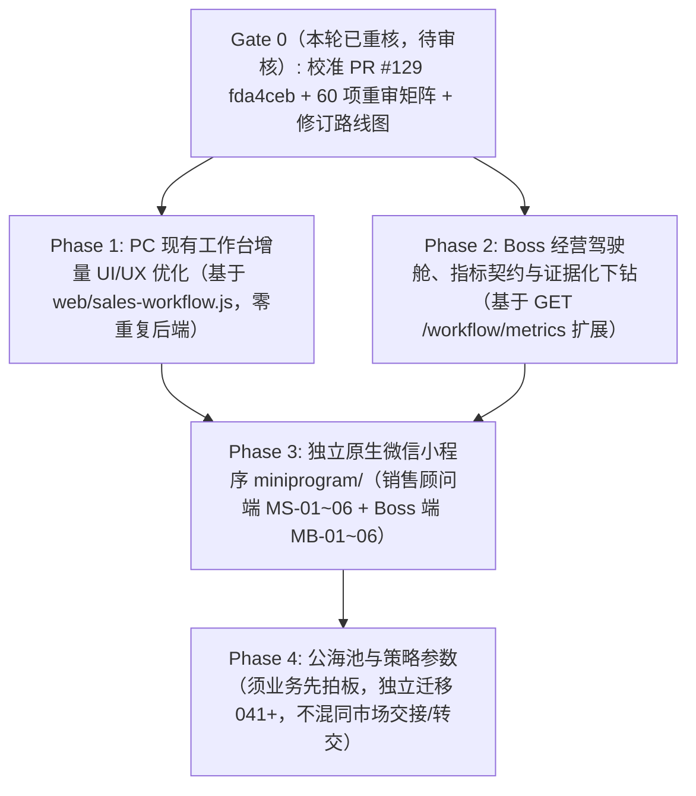

# 修订版增量实施顺序与验收标准（基于 PR #129 `fda4ceb`）| REVISED_ROADMAP_AND_ACCEPTANCE

修订日期：2026-11-19 ｜ 状态：**REVIEW_REQUIRED（仅规划，待审核，未批准改动业务代码）**
对齐基线：[`chatgpt/v3-2-121-m02-revocation-notices`](https://github.com/Lizhaochuan/market-sales-system/tree/fda4ceb8063248caed0a5f55f7c69d17fbaa8e74) @ `fda4ceb8063248caed0a5f55f7c69d17fbaa8e74`
审核参考：[`handoff/AUDIT_REVIEW_20261119.md`](AUDIT_REVIEW_20261119.md)、[`handoff/CORRECTED_IMPLEMENTATION_PLAN.md`](CORRECTED_IMPLEMENTATION_PLAN.md)、[`handoff/DECISION_LOG.md`](DECISION_LOG.md)

---

## 一、核心纠偏与不可妥协红线

1. **彻底取消原规划 `P0-A` 重复建设**：`039_v34_sales_loop.sql`（防断链延迟约束、`lead_workflow`、预约、报名、收退款、草稿、价目）与 `040_role_workspaces.sql`（部门隔离、`lead_directory` 电话查重与市场交接）已在 PR #129 落地并通过回归测试，**严禁另建第二套任务/面谈/工作流表或重用 `039`/`040` 迁移编号**。
2. **锁定已确认业务规则（禁止再次提案改写）**：
   - 学生主线、家庭按需核验关联、禁止按手机号自动合并学生 (`BR-M04-001`)；
   - 线上优先促面谈、支持非线性路径、事件事实不可由阶段替代 (`MS-SALES-001`)；
   - Open Lead 必须有负责人与明确下一步、原子接续、不断链 (`MS-FOLLOW-001`)；
   - 独立面谈与试听、面谈免填地点 (`0b60319`)、试听教室名称预留 `options.classrooms`、时间到达不自动完成 (`MS-TRIAL-001`)；
   - **报名成功标准 B = 主管独立核实有效协议 (`agreement_confirmed=true`) + 核款员独立核实有效正额净收 (`net_cents > 0`)**；意向单/报价绝不是标准 B；**正式 Closed Won = 全部有效订单全额净收 (`balance_cents === 0`) + 无未决款项/纠正 + 写入唯一 `ms.sale_events`** (`MS-WON-001`)；
   - 转交必须走“主管申请 → 另一独立主管复核 → 接收人确认接手”，Boss 督办不得绕过该审批流 (`MS-ASSIGN-001`)；
   - 部门隔离与权限实时重校验 (`MS-PERM-001`)；不修改、不对接 `edu-management-system` (`MS-CRM-001`)；
   - `EXT-001=UNVERIFIED`、`HOLD=true`、`release_eligible=false`、`merge_authorized=false`、`deploy_authorized=false`，PR #129 保持 Draft / CI-only (`MS-RELEASE-001`)。

---

## 二、真正需要新增与优化的功能清单（按四大实施阶段排序）

---

### Phase 1 — PC 销售工作台增量 UI/UX 优化（基于现有 `web/sales-workflow.js`，不建第二套工作流）

**设计前提**：完整保留并保护现有已验收的按角色首页（`我的待办` / `市场 Leads` / `收款核实`）、电话查重与市场交接、单项连续操作卡片、面谈免填地点、试听教室字段、内存草稿保护（禁写 `localStorage`/`sessionStorage`）与 60s 静默刷新防丢失。**严禁恢复早期十模块密集 Tab 为主工作台。**

| 增量项 | 类别 | 具体改动范围（仅在既有模块内增量演进） | 保护约束 |
|---|---|---|---|
| **PC-01** | 优化既有 | **我的待办快捷过滤与紧迫度视觉**：在 `web/sales-workflow.js` `renderRoleTasks` 增加快捷过滤胶囊（全部当日 / 已逾期 / 今日面谈试听 / 待审批或待接手）与逾期时长标识，维持“仅选定日期 + 实际逾期，不展示未来第三栏”的简化设计 | 不改 `reminders` / 逾期按实际今天判定的口径 |
| **PC-02** | 优化既有 | **宽屏侧边详情与列表上下文保留**：在 `>=1280px` 视口下，从“我的待办”或“我的客户列表”打开客户时支持侧边详情容器或保留列表筛选/滚动状态，返回后不丢筛选条件；保留单项卡片一次只展开一张表单的防拥挤体验 | 保持未保存表单刷新保护与撤权即时清理 |
| **PC-03** | 优化既有 | **客户列表紧凑列式视图 & 联系方式脱敏**：在 `renderPhoneIntake` 既有“我的客户列表”增加列表/卡片切换，展示学生、阶段、来源、最近结果、面谈/试听状态、下一步及逾期红标；列表默认脱敏展示电话，完整号码仅在授权详情页按需可见 | 严禁市场内部备注泄露给销售；严禁绕过电话查重直接重录 |
| **PC-04** | 新增只读 | **只读阶段看板 (`Kanban`)、周日程 (`Calendar`) 与 Saved Views**：基于当前授权 `GET /workflow` 与 `reminders` 提供只读投影视图；可选在新建迁移中保存用户筛选视图 | **看板严禁拖拽直接改写“已到访 / 已试听 / 已报名 / 已收款”事实**；任何状态变更必须呼出既有操作卡片并经原 API 校验 |
| **PC-05** | 验证既有流程 | **手动安排下次跟进时间**。销售选择具体日期和时间，保存后可在对应日期的待办查看。2026-11-20 确认保留手动选择及现有「明天 / 三天后 / 一周后」预设，取消新增「+2 小时 / +4 小时」及营业时间顺延规则。 | 验证手动输入覆盖已有预设，重新登录仍能查到所选时间。 |

**Phase 1 验收标准**：
- 既有回归零破坏：Node/PG 全部接口/权限/安全回归 + 独立 LOGIN/RLS + 既有合约 + 全部 Chromium 用例（含 `v34-workflow.spec.mjs`、`zz-role-workspaces.spec.mjs` 跨越 61 秒未保存保护、撤权清理、390px 窄屏）100% 通过。
- 新增验证：宽屏（`1440×900`、`1280×720`）侧边详情开关不丢筛选与滚动位置；只读看板无法通过拖拽伪造到访/试听/报名/收款；列表电话脱敏且不泄露市场内部备注。

---

### Phase 2 — Boss 经营驾驶舱：指标契约优先与证据化下钻（基于 `GET /workflow/metrics` 扩展）

**设计前提**：复用并扩展 [`src/sales-workflow.mjs#L315-L349`](https://github.com/Lizhaochuan/market-sales-system/blob/fda4ceb8063248caed0a5f55f7c69d17fbaa8e74/src/sales-workflow.mjs#L315-L349) 的 `metrics()` 与真实订单/收退款账本，**不建立独立的第二套指标事实源**。优先落地高价值的**“异常 → 顾问/渠道 → 学生 → 原始事实 → 合规督办”闭环**，不为了凑 22 张卡堆砌空图表。

#### 2.1 必须严格修正的数据口径契约
1. **明确三种去重主体，严禁混用**：
   - **Lead 粒度**（唯一 `lead_id`）：适用于新增线索、有效线索、待补安排、已结案 Won/Lost、无学生归属线索（`unidentified_leads` 单列）。
   - **学生粒度**（唯一 `student_id`）：适用于已识别学生数、有效联系学生、面谈预约/到访学生（主动到访单列，不混入预约到访率分母）、试听预约/完成学生、面谈/试听后报名成功学生（要求完成时间 $\le$ 首次报名成功时间）。
   - **事件/订单次数**（`activity_counts` / `orders`）：单独标注为次/单，绝不直接除以唯一学生/Lead 分母充当转化率。
2. **非线性路径漏斗口径**：
   - 提供 **队列（Cohort，锚定窗口内新建 Lead）** 与 **当期发生量（Event，统计窗口内实际发生事件）** 双口径切换。
   - 因为允许跳过面谈直约试听或跳过试听直接报名，不宣称严格阶梯嵌套，而是在漏斗旁单列非线性直达计数（`direct_to_trial_students`、`direct_enroll_without_trial_students`）。
3. **标准 B 与正式 Closed Won 严格分列**：
   - **`M15` 报名成功（标准 B）**：`agreement_confirmed = true AND net_cents > 0`（首次成功按 `first_success_at` 计唯一历史成功事件，与当前有效报名订单分开，退款不制造第二次报名成功）。
   - **`M14` 正式 Closed Won**：全部有效报名订单已全额净收 (`balance_cents === 0`)、无未决款项/纠正且已写入唯一 `ms.sale_events`。
   - **渠道成本 (`M17`–`M19`)**：在未接入经审核的真实费用归属证据前，统一返回 `COST_NOT_CONFIGURED`（页面显示“待配置成本源”），不伪造 ROI 或 `¥0` 成本。
4. **时态快照 `as_of_at` 与下钻权限一致性**：
   - **严禁仅靠 `created_at <= as_of_at` 冒充历史状态重建**；历史时态切片必须基于不可变事件/版本记录（`ms.audit_events.happened_at`、`ms_workspace.history`、`payment_receipt_projections.verified_at`）按 `<= as_of_at` 还原当刻状态。
   - **汇总与下钻共用同一套权限裁剪与筛选 SQL**；每次下钻请求服务端实时重查操作人角色与撤销状态，禁止跨机构/跨部门越权下钻（市场主管只看市场，销售主管只看销售，仅总管理者可跨看两部门）。
5. **合规管理督办 (`ManagementAction`)**：
   - 仅支持符合既有权限边界的督办动作：**限期催办跟进**、**发起转交申请（仍须经另一独立主管复核 + 接收人确认，绝不绕过审批一键改派）**、**要求预约结果核销**、**标记重点协同**。
   - **证据化销项**：每类督办绑定对应完成条件（例如：“催办预约结果核销”须有该预约的 `completed/no_show/cancelled/rescheduled` 记录；“催办待补安排”须修复 `primary_activity_id`；“催办超期跟进”须有督办下发时间之后的真实沟通/活动处理记录），**不允许任意一条无关跟进自动消除全部督办**。

#### 2.2 Phase 2 增量交付清单
- **后端**：扩展 `GET /workflow/metrics`（支持 `start_at / end_at`、`Asia/Shanghai` 窗口、`view_mode=cohort|event|snapshot`、`owner_id`、`source`、`as_of_at`）；新增只读 `GET /workflow/metrics/drilldown`（与汇总共用权限及筛选，逐次鉴权，不走写入请求回执）；新增独立隔离迁移（如 `041_boss_supervision_and_views.sql`）承载 `ms_workspace.management_actions`（督办单）与可选 `saved_views`。
- **前端**：升级 `renderMetrics` 为结构化 Boss 驾驶舱视图（顶部筛选栏 + 异常优先置顶卡 + 核心转化/资金双口径卡 + Cohort/Event 切换 + 顾问过程榜 + 渠道质量榜 + 战败归因图 + 点击数字证据化下钻抽屉 + 合规督办派发与追踪）。

**当前增量范围**：明细支持 `metric=leads`（线索）、`metric=students`（未归档学生，按学生去重）、`metric=won_leads`（正式成交）及 `metric=lost_leads`（当前失单），沿用建档时间、当前顾问和原始来源筛选，通过 `page`、`page_size` 分页。建档口径汇总和明细分别读取当前状态。 原始来源对比按首次登记的标签归组，展示当前线索数与状态；未登记来源单列。渠道成本暂显示「待配置成本源」。 当期发生量按上海时间窗口统计建档及审计事件的系统记录时间，允许更早建档的线索产生当期事件。事件计数及明细共用同一批记录。明细仅展示关联线索、当前顾问与记录时间，沿用当前权限；线索历史时点支持 `as_of_at`，依据截至该时间的有版本审计记录还原线索状态。无有效状态证据单列，汇总与明细共用口径。历史活动用 `ms_workspace.history` 截至所选时点的最后版本统计未完成与逾期，并提供同口径分页明细。未完成活动无有效到期时间时仍计入未完成，同时单列证据不足，且不计逾期。历史资金显示截至所选时点、可由工作台已核实版本与独立收退款投影交叉核对的收款、退款及净额，按核实时间累计并提供分页明细。历史应收、余额、外部财务修订与学生关联仍待接入。访问和顾问筛选沿用当前权限和负责人。

**Phase 2 验收标准**：
- 角色与机构隔离测试：销售顾问无法访问他人/团队汇总与下钻；市场主管仅见市场维度；财务核实员无法经下钻读取销售沟通详情；撤权后进行中的下钻请求 fail-closed 返回 `403`。
- 口径与数学不变量测试：同一学生多次沟通/多次改期/多次试听在学生去重指标中仅计 1 人；主动到访不混入预约到访率分母；先报名后试听不计入试听促成报名；`M15` 与 `M14` 严格分离（未核实协议或未核实首款不计入 `M15`，部分付款不计入 `M14`）；汇总唯一人数 === 下钻分页总数（同 `as_of_at` 时态快照）。
- 合规督办测试：督办无法绕过双主管转交审批直接换负责人；不符合督办证据条件的普通记录不能误销项。

---

### Phase 3 — 独立原生微信小程序（销售顾问端 `MS-01`–`MS-06` + Boss 管理端 `MB-01`–`MB-06`）

**设计前提**：已核实仓库内 **0 行小程序代码**。新建独立 `miniprogram/` 原生工程（WXML / WXSS / ES6 JS），**直接复用现有 `src/sales-workflow.mjs`、`src/role-workspaces.mjs` 及 Phase 2 扩展后的 Boss 接口**，不重建数据库与销售状态机。

| 端与页面 | 核心范围 | 强制安全与边界约束 |
|---|---|---|
| **共享底座** | 独立 `miniprogram/` 工程 + 审查后的内部员工最小权限登录/会话绑定接口 + 角色 4-Tab 路由（顾问 / 销售主管 / 市场 / 总管理者） | 微信登录绑定、AppID、合法域名、订阅消息均标注为**外部平台受限依赖**；未绑定的外部微信访客一律拦截 |
| **销售顾问端 (`MS-01`–`MS-06`)** | `MS-01` 今日待办与实际逾期、`MS-02` 电话查重/市场接收与我的客户卡片、`MS-03` 客户概览与时间轴、`MS-04` 单屏记跟进与下一步、`MS-05` 面谈（免地点）/试听（教室预留）预约与结果/改期、`MS-06` 移动日程与待接手转交 | **草稿安全**：优先内存状态 + 复用服务端受控草稿 `POST /workflow/{id}/draft`；若确需 `wx.setStorageSync`，须单独安全审批（最小字段、TTL、登出/撤权立即清空，**严禁缓存明文家长电话、凭证或登录密钥**）；遵守“不自动核款、不自动完成试听、不绕过转交审批” |
| **Boss 管理端 (`MB-01`–`MB-06`)** | `MB-01` 移动经营总览与异常置顶、`MB-02` 渠道/顾问对比、`MB-03` 统一口径下钻列表、`MB-04` 只读审计详情、`MB-05` 合规督办与独立审批入口、`MB-06` 督办证据化闭环追踪 | 与 PC 端 100% 共用 Phase 2 指标与下钻接口，绝不把意向单当标准 B，绝不绕过双主管审批 |

**Phase 3 验收标准（严格区分验证环境，禁止混报）**：
1. **后端跨端一致性与安全测试（PostgreSQL + HTTP）**：PC 与小程序写入同一 Lead 的实时互通、`expected_version` 并发冲突 (`409`)、`Idempotency-Key` 弱网重放幂等、越权与撤权实时 `403` 拦截。
2. **原生微信小程序验证（微信开发者工具 / 真机）**：单独记录编译结果、WXML/WXSS 真机视口（375/390/414px）零横向溢出、权限撤销后草稿清理与实机交互结果。**严禁用 H5 窄屏浏览器截图替代或冒充原生微信小程序验收**；若当前云端 CI 无微信开发者工具，则在测试报告中明确标注“原生开发者工具/真机待人工环境验证”，与 H5/API 自动化结果严格分开列示。

---

### Phase 4 — 公海池与策略参数（须业务单独拍板后方可进入开发）

**设计前提**：
- 严格保留 V3.4 已验收的 **市场→销售电话交接 (`lead_directory`)** 与 **双主管审批+接收人确认转交 (`lead_transfer`)**，**绝不将二者改名或混同为公海池**。
- 在没有业务签字批准公海策略之前，**严禁上线自动回收定时任务或无审批抢单**。
- 经业务拍板后，采用独立新增迁移编号（如 `042_public_pool_policy.sql`，**绝不覆盖/回滚 `039`/`040`**）实施：
  - 公海入池保护（默认豁免已有未来面谈/试听预约、合法暂缓期、已报名成功标准 B / 有未决财务事项的 Lead）；
  - 入池绑定明确值班管理责任人（不丢失跟进责任），认领/改派保留原任务、原到期日 (`original_due_at`) 与完整审计历史；
  - 接通 Boss `M22` 公海健康度指标与小程序 `MS-06` 公海认领视图。

---

## 三、数据库迁移与回滚底线规范

1. **禁止“删迁移文件即回滚”**：任何新增隔离迁移（`041+`）均须满足向前兼容（只增不破坏既有列/触发器/索引），并配套：
   - **特性开关快速撤回**（如 `MS_ENABLE_BOSS_COCKPIT=0` / `MS_ENABLE_PUBLIC_POOL=0` 关闭新路由与新 UI，立即退回 PR #129 既有行为）；
   - **向前兼容与显式补偿脚本**（对已写入的新表数据提供冻结/归档/数据迁移演练脚本，严禁直接 `DROP` 含业务审计记录的表）；
   - 严格沿用现有隔离数据库守卫（`current_database() IN ('ms_test','ms_workspace_test')`），不触碰生产环境与 `001`–`038` 核心表结构。

---

## 四、真正仍需业务确认的待决清单（仅列未决项，不重审已确认规则）

| 决策编号 | 待业务拍板事项 | 影响阶段 | 说明（审核前不自行假设） |
|---|---|---|---|
| **PENDING-01** | **公海池是否启用、自动回收阈值与保护清单** | Phase 4 | 是否启用自动回收？若启用，超期天数阈值、主管/值班负责人边界、认领上限与审批流是什么？ |
| **PENDING-02** | **校区营业时间窗口与首响 SLA 阈值** | Phase 2 | 例如是否按每日 `09:00–21:00` 折算首响时长 (`M03`)？首响超时告警阈值是 30 分钟还是其他？ |
| **PENDING-03** | **真实市场渠道费用来源与归属口径 (`M17`–`M19`)** | Phase 2 / 后续 | 是否允许在隔离端手工录入渠道周期投放费用，还是等待正式财务/M02 审批源？未确认前固定显示“待配置成本源”。 |
| **PENDING-04** | **微信小程序内部员工绑定方案、AppID 与订阅消息策略** | Phase 3 | 采用企业微信/微信 OpenID 绑定现有 `staff_users` 的具体审批流？是否有真实小程序主体、合法 HTTPS 域名与订阅消息模板？ |
| **PENDING-05** | **移动端本地草稿策略 (`wx.setStorageSync` 审批)** | Phase 3 | 默认采用“内存 + 服务端个人草稿 (`workflow-drafts`)”；如业务强需求断网本地持久草稿，须单独审批脱敏字段白名单、TTL 与撤权清理策略。 |
| **PENDING-06** | **原 V3.4 已声明的未核准政策边界** | 长期边界 | 生产 IAM/KMS/HSM/WORM、跨模块 `EXT-001` 验收、真实合同与资金权威、多人业绩分成与退款佣金冲回、跨学生共付款自动分配、零价/半课时报名政策（保持原 HOLD 不变）。 |
